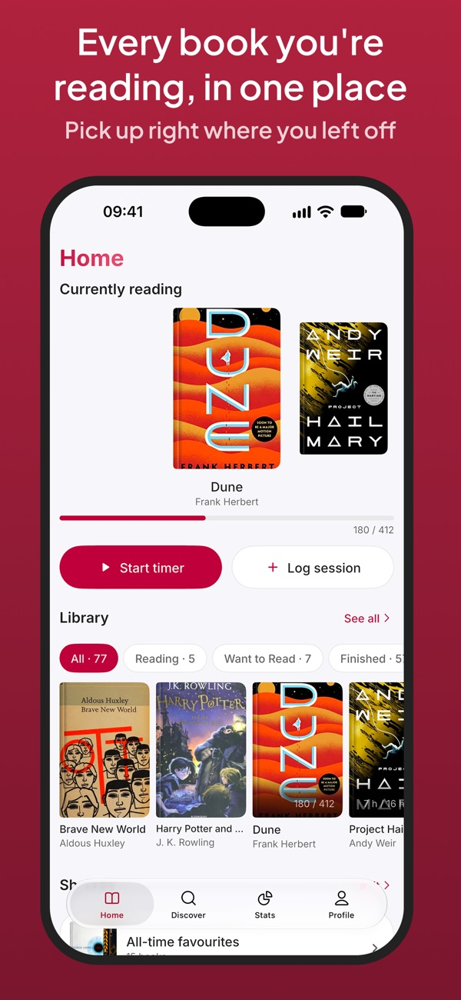
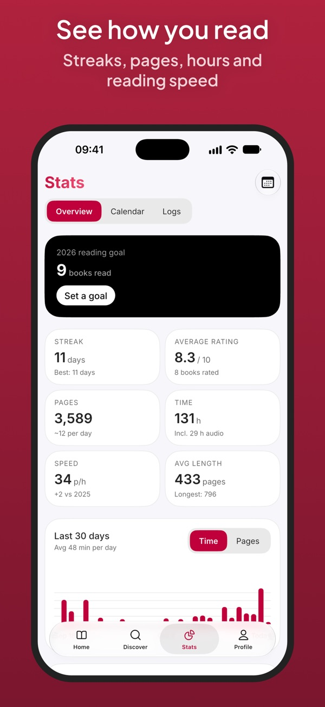
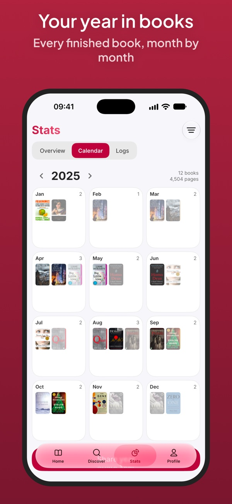

# Leaf for CrossPoint

Read on your CrossPoint e-reader (Xteink and other supported devices) and keep the record in Leaf without typing anything. How long you read, how many pages and where you stopped arrive on their own.

[Leaf](https://apps.apple.com/app/id6787546358) is a reading tracker app for iPhone and iPad, coming soon to Android. It keeps your library, times your reading, shows your stats and helps you reach your reading goals. This plugin connects your reader to it.

  

## What you get

Each time you leave a book or the reader goes to sleep:

- the session lands in the book's reading log, with its time and pages;
- the book's bookmark moves to where you stopped;
- your reading time, speed, pages and streaks in Leaf's stats follow.

At the end of the book, Leaf offers to mark it as read. Syncing with the reader needs no subscription.

## Requirements

- **CrossPoint 2.0 or later** ([releases](https://github.com/crosspoint-reader/crosspoint-reader/releases)). Releases up to 1.6.5 have no plugins.
- **Plugins turned on**: Settings → Connectivity → Plugins → Enabled.
- **The Leaf app**, with Settings → E-reader.

## Install with Plugin Hub

1. Connect the reader to Wi-Fi.
2. Home → Plugins → **Plugin Hub** → Install. If Plugin Hub is already there, open it.
3. In Plugin Hub: Community Plugins → **Leaf: Reading Tracker** → Install.
4. **Restart the reader.** The firmware collects event subscriptions at boot, so until a restart no session is sent.
5. Check: Home → Plugins → Leaf: Reading Tracker shows the plugin's text.

Updates come the same way: Plugin Hub shows the new version, press Update and restart the reader. The connection to your account survives an update.

## Install by hand

1. Download `leaf.zip` from the [latest release](https://github.com/color-hub/leaf.crosspoint-plugin/releases/latest) and unzip it.
2. Copy the `leaf` folder to `/plugins/` on the reader's card (or `/.crosspoint/plugins/`). **The folder must be named exactly `leaf`.** Over File Transfer: create `/plugins/leaf` and upload every file of the folder into it.
3. **Restart the reader** and check that Home → Plugins → Leaf: Reading Tracker shows the plugin's text.

## Connect to your account

1. In Leaf: Settings → E-reader → Connect a reader. Leaf shows an 8-character code, valid for 10 minutes.
2. On the reader, start File Transfer and open the address it shows in a browser on a phone or computer on the same Wi-Fi.
3. In the browser, open Settings, find the Leaf card, type the code and press Connect.
4. The card says "Connected …", and the reader appears under Settings → E-reader in Leaf.

The token is kept in `/.crosspoint/.leaf-token.json`, outside the plugin's folder. Disconnect on the card erases it from the reader. Disconnect in Leaf revokes it on the server.

## The first book

Read a few pages on the reader, then leave the book or put the reader to sleep. Leaf's home screen shows a "From the reader" card: pick which book it is. If the book has no page count, Leaf asks for it, because the reader keeps its position in percent and Leaf counts in pages. From then on every session of that file, including the ones already waiting, applies on its own.

## What leaves the reader

The plugin sends the book's path on the card, a hash of the file, when and how long you read, and your position in the book. Connecting also sends the reader's device ID. Nothing comes from the server to the reader, so the plugin never changes the position on it. [Privacy policy](https://colorhub.online/leaf/privacy).

## How it works, and the firmware's limits

- The firmware queues a `reader.session` event when you leave a book or the reader goes to sleep. Only forward page turns count, each page at least 2 seconds. A session under 10 seconds is not sent.
- The queue goes out on any Wi-Fi connection, when File Transfer starts, and on the way to sleep (with at least 20% battery and a remembered network).
- **Until firmware PR [#3867](https://github.com/crosspoint-reader/crosspoint-reader/pull/3867) lands**, Wi-Fi comes up before sleep only if the Wi-Fi screen was opened at least once since power-on. Otherwise the sessions go out on the next connection.
- **Offline, the queue holds about 13 sessions.** When it overflows, the firmware drops all of it. Connect to Wi-Fi at least once every few days of reading.
- The reader never moves the bookmark back: if Leaf's is further on, it stays.
- The reader does not verify HTTPS certificates (that is how the firmware works). The token only lets its holder write sessions into your account.

## What is in this repository

- `leaf.crosspoint-plugin/`: the plugin exactly as it is installed on the card:
  - `manifest.json`: its name, version and the files Plugin Hub installs
  - `device.json`: the request the firmware sends for every `reader.session`
  - `plugin.js`: the Leaf card on the reader's web Settings page, which trades the code for a token
  - `README.md`: the text the reader shows when you open the plugin
  - `DETAILS.md`: the page Plugin Hub shows before you install
- `test/`: tests that hold the plugin to the firmware's and Plugin Hub's contracts and run the card against a fake reader.
- `docs/`: the images on this page.

## Development

```bash
npm ci
npm test
```

The tests copy the firmware facts they rely on (event variables, path limits, protected files) into `test/payload.js`. Re-check them against each new CrossPoint release.

### Releasing

1. Bump `version` in `leaf.crosspoint-plugin/manifest.json` and commit.
2. Tag the commit `v<version>` and push the tag.

The `release` workflow runs the tests, checks that the tag matches the manifest, attaches `leaf.zip` and publishes the release. Plugin Hub picks it up within three hours.

## License

The plugin's code in this repository is under the [MIT License](LICENSE): copy it, change it and use it however you like.

The license covers this repository's code and nothing else. The Leaf app, its server and its source code are proprietary and are not part of this repository. The Leaf name and logo and the app screenshots in `docs/` are not licensed for reuse, and a copy of this plugin gets no right to use Leaf's server.
